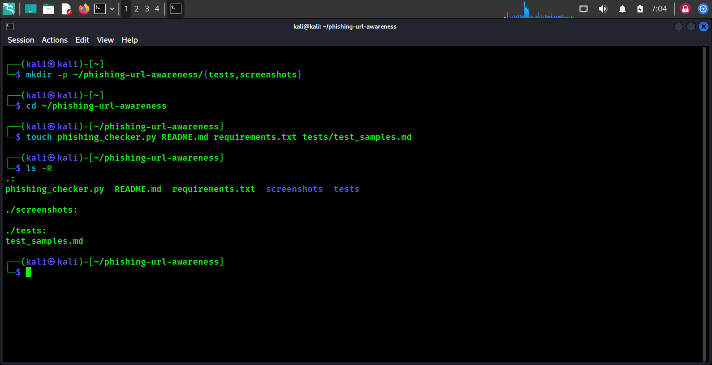
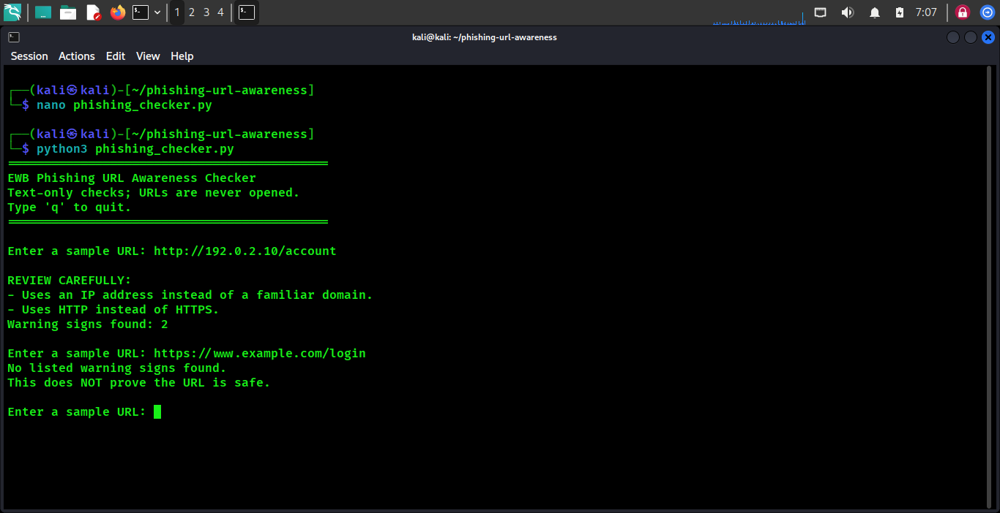
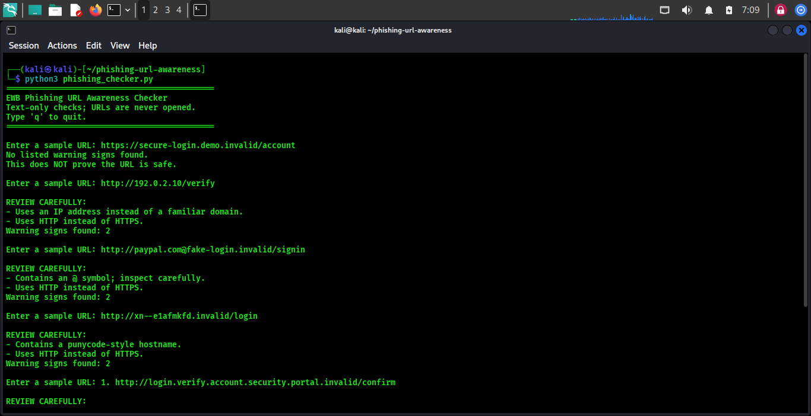
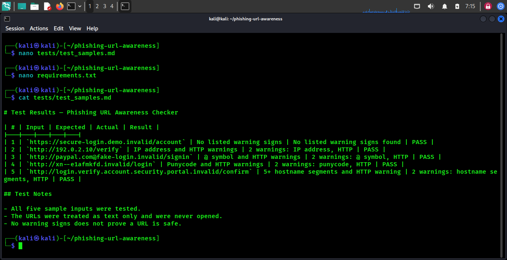

# Phishing URL Awareness Checker

**Author:** Dhoni KuMAR sHAH  
**Course:** EWB Courses  
**Language:** Python 3

## 1. Project Overview

The Phishing URL Awareness Checker is a beginner-friendly Python command-line project that identifies common warning signs in URL text. It helps users understand suspicious URL patterns for cybersecurity awareness.

The program only examines the text provided by the user. It never opens URLs or sends requests to websites.

## 2. Features

- Detects the `@` symbol in a URL.
- Flags URLs longer than 100 characters.
- Identifies IPv4 addresses used as hostnames.
- Detects hostnames with five or more segments.
- Checks for the `xn--` punycode marker.
- Flags HTTP URLs instead of HTTPS.
- Displays warning explanations and a warning count.
- Handles malformed or incomplete URL input.

## 3. Requirements

- Python 3.10 or later
- No additional Python packages required

## 4. How to Run

Open a terminal in the project directory and run:

```bash
python3 phishing_checker.py
```

Enter a sample URL when prompted. Type `q` to exit.

## 5. Testing

Five sample URL inputs were tested. The recorded expected and actual results are available in [`tests/test_samples.md`](tests/test_samples.md).

## 6. Screenshots

### Screenshot 1 — Project Setup



### Screenshot 2 — Program Execution



### Screenshot 3 — Test Results



### Screenshot 4 — Test Report



## 7. Improvements

1. Added validation for malformed or incomplete URL input.
2. Added clear warning explanations and a warning count.

## 8. Limitations

This is an educational awareness tool. It only analyses URL text; it does not visit URLs, scan websites, or query reputation services. No warning signs found does not mean a URL is safe.

## 9. Ethical Use

Use sample URLs for educational testing. Do not collect credentials, deceive users, or test websites without permission.